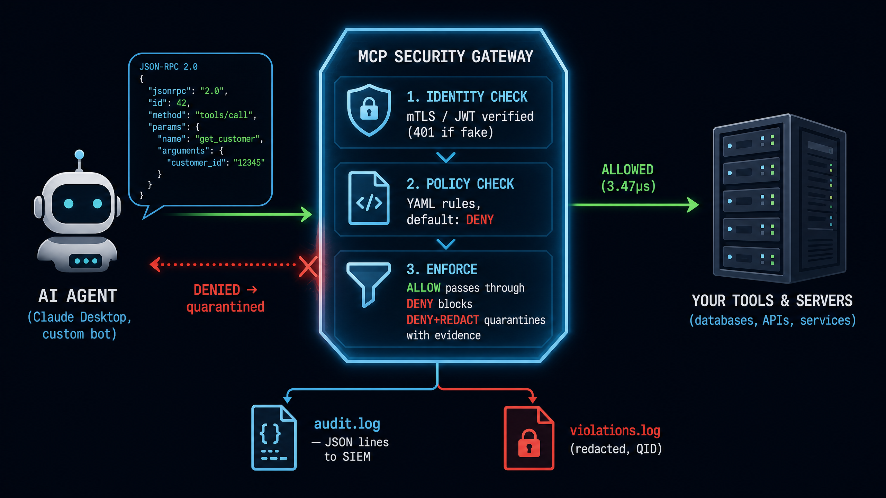

# MCP Security Gateway

> A zero-trust firewall for AI agents. The MCP Security Gateway sits between agents (anything speaking the Model Context Protocol) and the tools they call — verifying identity, enforcing default-deny YAML policies, and quarantining violations with redacted evidence.



| | |
| --- | --- |
| ⚡ | **3.47µs** worst-case policy decision across 200 rules (CI gate: <5ms) |
| 🧪 | **83%** test coverage · adversarial attack suite · `-race` clean |
| 📦 | ~15MB distroless Docker image · Helm chart · Kubernetes sidecar pattern |
| 🛡️ | Identity-first (mTLS/JWT) · default-deny · deny-with-redact quarantine |

## Quick Start

```bash
# Run a toy upstream
go run ./cmd/stub-mcp-server --port 8090

# Run the gateway in front of it
go run ./cmd/mcpgateway \
  --policy examples/policy.yaml \
  --upstream http://127.0.0.1:8090 \
  --listen 127.0.0.1:8080

# Call it like an agent would
curl -X POST http://127.0.0.1:8080 -H "Content-Type: application/json" \
  -d '{"jsonrpc":"2.0","method":"tools/call","params":{"name":"db.execute_sql","arguments":{"q":"SELECT 1"}}}'
```

Unauthorized calls are denied, assigned a quarantine ID, and streamed to `audit.log`. Allowed calls pass through invisibly.

## With Docker / Kubernetes

```bash
docker run -p 8080:8080 -v $(pwd)/examples/policy.yaml:/etc/gw/policy.yaml \
  mcp-gateway:v6 --policy /etc/gw/policy.yaml --upstream http://host:8090

helm install mcp-gw deploy/helm/mcp-gateway/ --set upstream=http://your-mcp-server:8080
```

## Policy in 30 seconds

```yaml
version: "1.0"
default_action: deny            # nothing happens unless a rule says so
rules:
  - id: R-001
    action: deny
    agent: "finance-agent"
    tool: "db.execute_sql"
  - id: R-002
    action: deny_with_redact    # deny + strip secrets + quarantine evidence
    agent: "*"
    tool: "db.*"
    redact_fields: ["connection_string", "raw_query"]
    expires_at: "2026-12-31T23:59:59Z"
    reason: "pending schema audit"
```

Every `allow` requires a written `reason` and an `expires_at` — the schema refuses exceptions without them. Policies hot-reload with zero dropped connections.

## Architecture

Built in six stages with documented decisions: **identity** (JWT/JWKS, mTLS/SPIFFE extraction) → **policy** (pure-Go evaluator, strict YAML loader, org/team inheritance with ShadowBlock precedence) → **enforcement** (redaction manifests, upstream Ed25519 identity attestation) → **resilience** (token-bucket rate limiting, slow-loris timeouts, atomic hot reload, SIGTERM drain) → **visibility** (JWT-RBAC console, streaming gzip forensic export) → **delivery** (distroless image, Helm chart, CI gates).

The full reasoning lives in the ADR log: 17 recorded architecture decisions. See the [docs-pack](docs-pack/) for the SDLC workbook, QA log, and implementation record.

## Verification

```bash
go test -count=1 -race ./...          # green, race-free
go test -bench=Evaluator ./pkg/policy/ # worst case 3.47µs (gate: 5ms)
```

Attack fixtures in `tests/adversarial/attacks/` (unauthorized tool calls, SQL injection into allowed tools) run against both MCP spec versions.

## Contributing & Security

See [CONTRIBUTING.md](CONTRIBUTING.md) for the workflow (latency gate, coverage floor, adversarial tests required for new features). Security findings go to the address in [SECURITY.md](SECURITY.md) — coordinated disclosure only, never a public issue.

**License:** Apache 2.0
